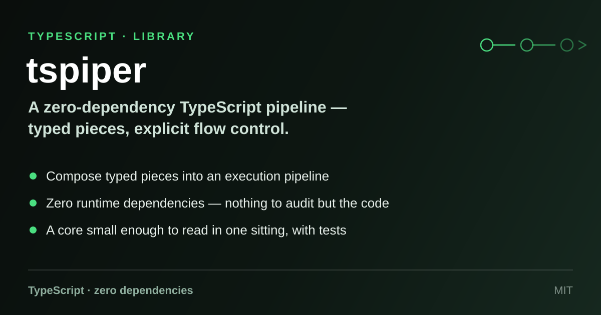

# tspiper

<p align="center">
  
</p>

<p align="center">
  <a href="LICENSE"></a>
  
  
</p>

A tiny, zero-dependency TypeScript library for building **named execution
pipelines**. You register *pieces* (units of work) under a pipeline name, then
execute that pipeline against a shared context object. Each piece receives the
context, transforms it, and hands it to the next piece — with a `PipeFlow` flag
to short-circuit the chain at any point. That's it: no runtime dependencies, no
framework, roughly a hundred lines of code you can read in one sitting.

## Features

- **Zero runtime dependencies** — the published code is plain ES6-target
  JavaScript with type declarations; nothing else comes along for the ride.
- **Fully typed** — every export is an interface, enum, or class; your pieces
  and contexts are checked end to end.
- **Async by design** — pieces return promises, so I/O-bound steps fit
  naturally.
- **Flow control** — a piece can stop the pipeline by setting
  `context.flow` to anything other than `PipeFlow.CONTINUE`.
- **Lazy pieces** — pipes are registered as factories (`() => IPiece`), so a
  fresh piece instance is created per execution.
- **Tested** — the behaviour described here is covered by the Jest suite in
  `src/__tests__/`.

## Usage

A pipeline is a named list of piece factories. Define a context, define your
pieces, register them, execute. (This example is lifted almost verbatim from
the test suite.)

```ts
import { IPerContext, IPiece, PipeFlow, Piper } from 'tspiper';

// 1. A context: the state object threaded through the pipeline.
class MathContext implements IPerContext {
  public debug: { currentPipe: string };
  public flow: PipeFlow = PipeFlow.CONTINUE;
  public output: number;
  constructor(public input: number[]) {}
}

// 2. Pieces: units of work that transform the context.
class Sum implements IPiece {
  public async execute(context: MathContext): Promise<MathContext> {
    context.output = context.input[0] + context.input[1];
    return context;
  }
}

class AddProduct implements IPiece {
  public async execute(context: MathContext): Promise<MathContext> {
    context.output = context.output + context.input[0] * context.input[1];
    return context;
  }
}

// 3. Register and execute.
const piper = new Piper();
piper
  .addPipe('math', () => new Sum())
  .addPipe('math', () => new AddProduct());

const result = await piper.execute('math', new MathContext([500, 2000]));
console.log(result); // output === 500 + 2000 + 500 * 2000 === 1002500
```

### Stopping a pipeline early

Set `context.flow` inside a piece; execution halts before the next piece runs:

```ts
class Guard implements IPiece {
  public async execute(context: MathContext): Promise<MathContext> {
    if (context.input.length < 2) {
      context.flow = PipeFlow.BREAK; // later pieces are skipped
    }
    return context;
  }
}
```

### Composing pieces

Since a piece is anything with an `execute(context, args?)` method, you can
build a composite piece that runs sub-pieces in sequence and register it as a
single pipe — the test suite includes a small `Composition` class doing exactly
that.

## API overview

Everything is exported from the package root.

| Export | Kind | Purpose |
|---|---|---|
| `Piper` | class | The pipeline registry and executor. |
| `IPiper` | interface | Contract implemented by `Piper` (`addPipe`). |
| `IPiece` | interface | A unit of work: `execute(context, args?): Promise<IPerContext>`. |
| `IPipeFactory` | type | `() => IPiece` — how pieces are registered. |
| `IPerContext` | interface | The state threaded through a pipeline: `{ debug: { currentPipe: string }, flow: PipeFlow }`. |
| `PipeFlow` | enum | `CONTINUE`, `BREAKONE`, `BREAK`. |

### `Piper`

- **`addPipe(identity: string, pipe: IPipeFactory): IPiper`** — append a piece
  factory to the pipeline named `identity` (created on first use). Returns
  `this`, so calls chain.
- **`execute(identity: string, context: IPerContext, args?: any): Promise<IPerContext>`** —
  run the pipeline named `identity`. Each factory is invoked to create a fresh
  piece, which receives the context (and optional `args`) and returns it,
  possibly mutated. Execution stops as soon as `context.flow` is anything
  other than `PipeFlow.CONTINUE`. Executing an unknown identity is a no-op and
  simply returns the context.

> **Note on `PipeFlow`:** the current executor treats `BREAKONE` and `BREAK`
> identically — any non-`CONTINUE` value stops the whole pipeline.

## Contributing

Contributions are welcome — see [`CONTRIBUTING.md`](CONTRIBUTING.md).

## License

MIT — see [`LICENSE`](LICENSE).
